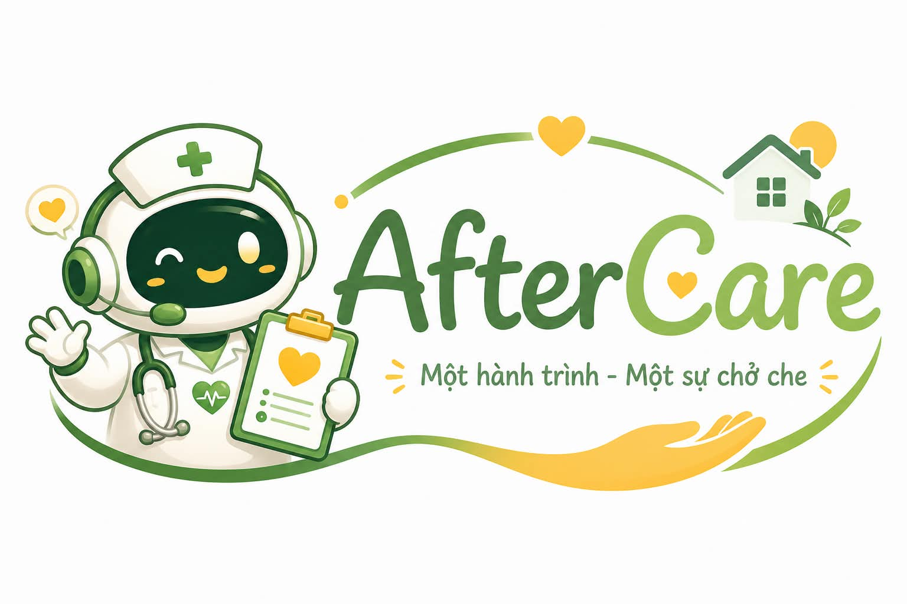
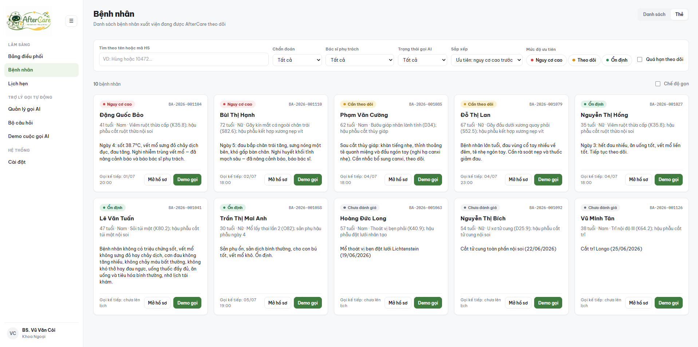
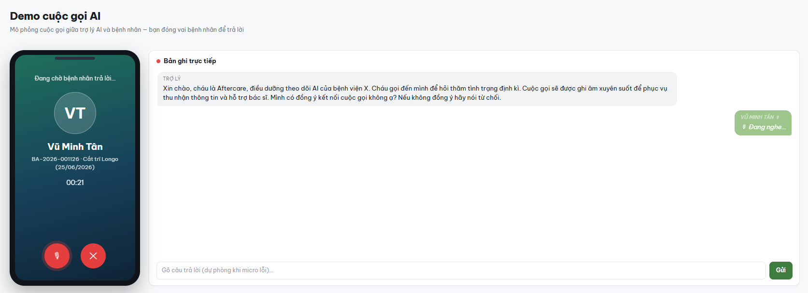
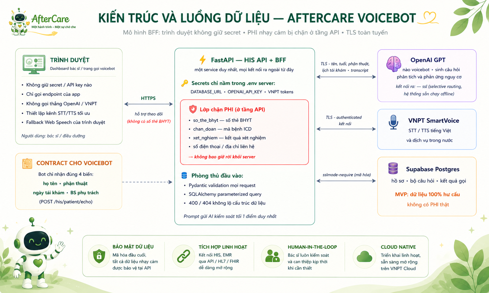
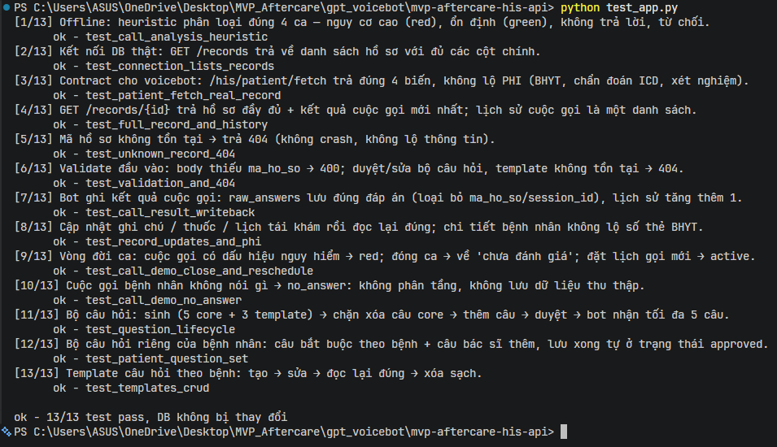
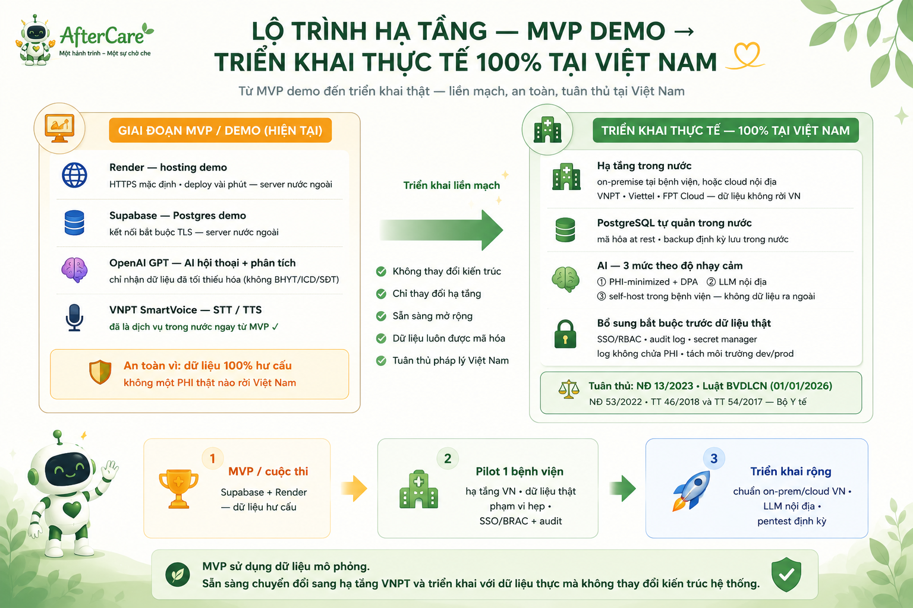

<div align="center">



#  AfterCare: Post-Discharge Patient Monitoring System

**An AI voicebot that calls patients after discharge, summarizes each call, stratifies risk, and alerts doctors.**


[Tiếng Việt](README.md) | **English**

</div>

Post-surgery patients who go home are often "lost from view" until their follow-up visit. **AfterCare** fills that gap:
doctors review a follow-up question set for each patient, an AI voicebot calls them on a schedule, and the system
automatically summarizes the conversation, classifies risk, and pushes alerts for cases that need intervention.

---

## 📋 Table of Contents

- [Features](#-features)
- [Demo UI](#️-demo-ui)
- [Architecture](#-architecture)
- [Project Structure](#-project-structure)
- [Setup and Test Script](#-setup-and-test-script)
- [Environment Variables](#️-environment-variables)
- [Main API](#-main-api)
- [Deployment Notes](#-deployment-notes)

## ✨ Features

- **Patient dashboard**: list of post-surgery records with latest risk tier, last call,
  next scheduled call, overdue follow-ups, and follow-up appointments.
- **Question set generation & review**: a **CORE** group of danger-sign questions (fever, surgical wound, pain,
  bleeding, shortness of breath) is locked and cannot be deleted. Personalized questions are generated by GPT from the
  patient record (surgery, prescribed medication, monitoring notes). A doctor edits and approves the set before it is used for calls.
- **GPT voicebot**: opens with a fixed request for consent to record, confirms the patient's identity, asks the approved
  questions one by one, and may ask clarifying questions but **never diagnoses**.
- **Vietnamese voice**: STT/TTS via VNPT SmartVoice (multiple regional voices). If not configured, the browser
  automatically falls back to the Web Speech API, so the demo still runs.
- **Call analysis**: summarizes the conversation, extracts answers per variable (`sot` = fever, `vet_mo` = surgical wound, …),
  assigns a risk tier and a doctor escalation flag. Uses GPT when available, otherwise a keyword heuristic, so the
  whole pipeline can run offline.
- **Alerts & case lifecycle**: notifications for high-risk or overdue patients. Closing a case resets the patient to
  "not yet assessed" while keeping the full call history.
- **Data security**: all secrets (OpenAI, VNPT, DB) live on the server only. The browser only calls the app's own
  endpoints (BFF pattern). Sensitive PHI (`so_the_bhyt` = health insurance card number, ICD codes, lab results) is never
  sent to the bot or exposed through the API.

## 🖥️ Demo UI

**Patient dashboard**: risk tiers 🟢🟡🔴, last call, next scheduled call, overdue cases:



**Demo call with the voicebot**: opens with a recording consent request, then asks the doctor-approved question set:



## 🏗 Architecture



Workflow: **view patient → generate & approve questions → voicebot calls → analysis & risk stratification
→ dashboard & alerts → close case / schedule next call**.

## 📁 Project Structure

```
mvp-aftercare-his-api/
├── app/
│   ├── main.py           # All FastAPI endpoints + static frontend mount
│   ├── gptbot.py         # GPT brain of the voicebot (replaces the old VNPT Smartbot)
│   ├── call_analysis.py  # Summary + risk stratification (GPT / offline heuristic)
│   ├── questions_gen.py  # Question set generation (CORE + personalized / template)
│   ├── smartvoice.py     # VNPT SmartVoice STT/TTS client (creds stay server-side)
│   ├── smartbot.py       # Old VNPT Smartbot client (legacy, no longer used)
│   ├── models.py         # SQLAlchemy models matching the existing Supabase schema
│   ├── schemas.py        # Pydantic request/response models
│   ├── config.py         # Environment variables (pydantic-settings)
│   ├── db.py             # Engine + session (Supavisor session pooler)
│   ├── seed_demo.py      # Seeds demo data, safe to re-run (idempotent)
│   └── static/           # Frontend: patients, case, questions, call, manager…
├── create_tables.sql     # Creates AfterCare-side tables (idempotent)
├── test_app.py           # Automated tests (offline + smoke + write-rollback)
├── .env.example          # Environment variable template
└── requirements.txt
```

> 💡 The `../SmartVoice/` folder next to the repo holds VNPT SmartVoice API docs and a Postman collection
> for reference. It is not code.

## 🚀 Setup and Test Script

**Requirements:** Python 3.11+ and a Supabase Postgres database that already has the `"Hồ sơ bệnh nhân"` (patient records) table.

Install & run in **one command** (after filling `DATABASE_URL` in `.env`, copied from `.env.example`):

```bash
pip install -r requirements.txt && uvicorn app.main:app
```

Step by step for the first run:

```bash
# 1. Install dependencies
pip install -r requirements.txt

# 2. Configure
cp .env.example .env        # fill DATABASE_URL (required), other keys optional

# 3. First run only: create tables + seed demo data
#    run create_tables.sql in the Supabase SQL editor, then:
python -m app.seed_demo

# 4. Run
uvicorn app.main:app --reload
```

Open <http://localhost:8000>. The frontend is served directly by FastAPI. Swagger UI is at `/docs`.

**Automated tests**: 16 tests covering classification logic (offline), read-only smoke tests, and every write endpoint
(each test is wrapped in a rolled-back transaction, so it **leaves no data behind** in the DB):

```bash
python test_app.py
```



## ⚙️ Environment Variables

| Variable | Required | Notes |
|---|:---:|---|
| `DATABASE_URL` | ✅ | Supavisor **session pooler** on port 5432, scheme `postgresql+psycopg`, username `postgres.[PROJECT_REF]`, URL-encoded password, `?sslmode=require`. ⚠️ Do not use the `db.[ref].supabase.co` host (IPv6-only). |
| `OPENAI_API_KEY`, `OPENAI_MODEL` | ➖ | Powers the voicebot, question generation, and call analysis. Without a key → template & heuristic fallback, demo still runs. |
| `SMARTVOICE_BASE_URL`, `SMARTVOICE_STT_*`, `SMARTVOICE_TTS_*` | ➖ | VNPT STT/TTS, separate creds per service. Any service left unset falls back to Web Speech in the frontend. |
| `SMARTVOICE_TTS_REGION`, `SMARTVOICE_TTS_SPEED` | ➖ | Voice (e.g. `female_north`, `male_south`…) and speed (0.5–2). |
| `BOT_ID`, `SMARTBOT_*` | ➖ | Legacy. The old Smartbot was replaced by GPT; leave empty. |

Secrets live only in `.env` (gitignored). The browser **never** calls OpenAI/VNPT directly;
that is why the `/bff/*` endpoints exist.

## 🔌 Main API

<details>
<summary><b>Dashboard / frontend</b></summary>

| Endpoint | Description |
|---|---|
| `GET /his/patients` | Patient list + risk tier, last call, next scheduled call |
| `GET /his/patient/{ma_ho_so}` | Record details (does not return `so_the_bhyt`) |
| `GET /his/patient/{ma_ho_so}/call-results` | Call history: transcript, answers, summary |
| `GET /his/patient/{ma_ho_so}/call-preview` | Script of the upcoming call (read-only) |
| `GET/POST/PUT/DELETE /his/templates` | Question templates per condition |
| `GET/POST/PUT/DELETE /his/escalation-rules` | Alert & doctor escalation rules (protocols) |
| `GET/PUT /his/call-settings` | AI call settings: call hours, retries, days off |
| `GET /his/performance` · `/his/notifications` · `/his/appointments` | Metrics, alerts, follow-up appointments |

</details>

<details>
<summary><b>Question sets</b></summary>

| Endpoint | Description |
|---|---|
| `POST /questions/generate` | Generate a draft for a patient |
| `PUT /questions/{set_id}` | Save edits (CORE questions cannot be deleted) |
| `PUT /questions/{set_id}/approve` | Approve a question set |
| `GET/POST /his/patient/{ma_ho_so}/question-set` | Patient-specific set: required questions per condition + extra questions |
| `POST /questions/ai-suggest` | AI suggests extra questions (preview only, not saved) |

</details>

<details>
<summary><b>Voicebot (BFF)</b></summary>

| Endpoint | Description |
|---|---|
| `POST /bff/conversation` | One GPT conversation turn: `{text, session_id, ma_ho_so, first_turn}` |
| `POST /bff/stt` · `POST /bff/tts` | VNPT SmartVoice proxy |
| `GET /bff/voice-config` | Tells the frontend which STT/TTS services are configured |
| `POST /his/call-demo/save` | Save a demo call: analyze + write to `call_results` |
| `POST /his/call-manual/save` | Save a manual call result (doctor calls and picks the outcome) |

</details>

<details>
<summary><b>Bot-facing / write-back</b></summary>

| Endpoint | Description |
|---|---|
| `POST /his/patient/fetch` · `/his/questions/fetch` | `set_variables` contract for the bot |
| `POST /his/call-result` | Bot writes the call result |
| `PUT /records/{ma_ho_so}/monitoring` · `ghi-chu` · `thuoc` · `lich-tai-kham` | Update monitoring, notes, medication, follow-up appointment |
| `POST /records/{ma_ho_so}/close` | Close the case (keeps call history) |
| `GET /health` | Health check (Render) |

</details>

> `ma_ho_so` = patient record ID.

## 📌 Deployment Notes

- Deployed as a **single web service** (already running on Render). All timestamps are stored as UTC-aware
  (`timestamptz`) so a local machine (UTC+7) and Render (UTC) stay in sync.
- Voicebot conversation history is kept **in RAM** (single process). To run multiple workers or survive
  restarts, move it to Redis or the DB.
- The demo works without OpenAI/SmartVoice keys: questions use templates, analysis uses the heuristic,
  and voice uses the browser's Web Speech API.

Infrastructure roadmap for real-world deployment (hosted 100% in Vietnam):



---

<div align="center">


<sub>MVP demo, not for medical diagnosis. The voicebot only checks in on patients and passes information to the attending doctor.</sub>
</div>
